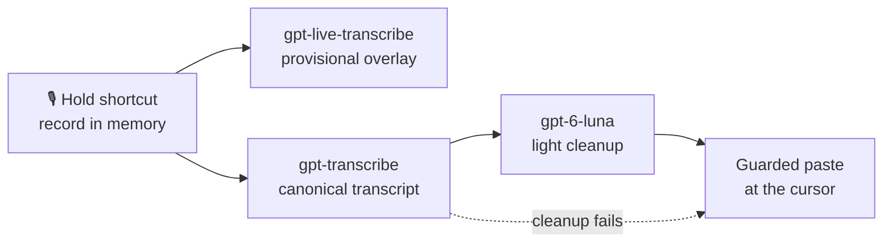

<div align="center">


# YapYap

**Talk it out.** Hold-to-talk dictation for your desktop, using your own OpenAI API key.

Hold your shortcut → speak → see words almost immediately → release → get an accurate, cleaned-up version at the cursor.


</div>

---

## Why YapYap

- **Bring your own key.** Audio goes straight to OpenAI. There is no dictation backend in between, and no analytics.
- **Feels instant, ends up accurate.** Live words show up in a floating overlay while you speak. When you release, the full recording is transcribed again for the final text.
- **Cleanup keeps your meaning.** An optional light pass removes filler words and fixes punctuation. Numbers, identifiers, URLs and filenames are left as you said them.
- **Your dictation isn't lost.** Audio and transcripts stay in memory. If a stage fails, you can retry, copy the original transcript, or paste again into a new target.
- **Safe insertion.** YapYap checks the destination before it pastes and refuses if the app, caret or window changed. Your clipboard is restored afterward, and a newer copy is never overwritten.

## How it works



When stages disagree, YapYap trusts them in this order:
**original audio › canonical transcript › cleaned transcript › live preview**.
Each phase can be turned off on its own under **Processing phases** in the app.

## Platforms

| Platform | Support |
| --- | --- |
| **Windows 11** (x64) | Installer on the [Releases](https://github.com/RexZhang4321/YapYap/releases) page. Windows 10 and ARM64 are untested. |
| **macOS** (Apple Silicon) | Works; [build from source](#macos-1) for now |
| **Linux** | Not supported |

### Known limitations

- **The Windows installer is not code-signed yet.** SmartScreen may warn you the first time you run it. Choose **More info → Run anyway** if you trust the download.
- **There is no downloadable macOS build yet.** It needs Developer ID signing and notarization first.
- **No automatic updates.** To upgrade, download and run the newer installer.
- **Pending audio is lost if the app quits or crashes.** YapYap keeps recordings in memory only, by design.
- **Needs an internet connection and an OpenAI API key.** There is no offline mode.
- **Windows can't paste into apps running as administrator.** Use **Copy** in YapYap and paste by hand.

Open work is listed in [TASKS.md](docs/dev/TASKS.md), and the reasoning behind decisions is recorded in [DECISIONS.md](docs/dev/DECISIONS.md).

## Install

### Windows

1. Download `YapYap_<version>_x64-setup.exe` from the [latest release](https://github.com/RexZhang4321/YapYap/releases/latest), run it, then launch **YapYap** from the Start menu.
   It installs for the current user only, in `%LOCALAPPDATA%\YapYap`. It needs no admin rights, except that Windows may ask for permission if it has to install the WebView2 runtime.
2. Open **Settings**, save your [OpenAI API key](https://platform.openai.com/api-keys), allow microphone access, and choose a shortcut. The default is `Ctrl+Alt+F8`.
3. Closing the window keeps YapYap running in the tray. Choose **Quit** from the tray to exit.

The [user guide](docs/USER_GUIDE.md) covers dictating, cancelling and recovering your words.

### macOS

No downloadable build has been published yet. To build and install locally, see [Develop → macOS](#macos-1).

## Cost

YapYap is free. OpenAI bills your API account directly for each dictation:

- a transcription of the full recording, when **Full audio transcription** is on;
- streaming transcription while you speak, when **Show live words** is on (or when full audio transcription is off, since the live transcript is then the final one);
- a short text request, when cleanup is on.

You can turn each of these off under **Processing phases** or in **Settings**. See [OpenAI pricing](https://developers.openai.com/api/docs/pricing) for current rates, and consider setting a usage limit in your OpenAI account.

## Develop

You need Node.js, Rust and the Tauri 2 prerequisites for your platform. All app source is in [`desktop/`](desktop/).

### Windows

```powershell
cd desktop
npm install
npm run tauri -- dev
```

To build a local unsigned installer, run `npm.cmd run release:windows`. The output goes to `desktop/src-tauri/target/release/bundle/nsis/`. See the [Windows release guide](desktop/RELEASE.md) for signing and release acceptance.

### macOS

```sh
cd desktop
npm ci
npm run dev:macos          # development app
npm run install:macos      # build, sign, replace /Applications/YapYap.app and launch it
```

`install:macos` keeps a single signed copy of the app. That way the Accessibility, Microphone and Keychain grants survive rebuilds.

### Tests

```sh
npm test                   # deterministic frontend and platform tests
npm run test:ui            # rendered UI checks (Playwright)
npm run test:group3        # macOS group 3 regression suite
```

Real API checks are opt-in. Regular tests use fixtures and fakes.

## Project layout

```
YapYap/
├── desktop/
│   ├── src/                 # React UI, dictation controller, session and recovery logic
│   │   └── platform/        # build-time platform modules (windows / macos / unsupported)
│   ├── src-tauri/           # Rust: capture, credentials, shortcuts, overlay, insertion, transport
│   └── scripts/             # tests, smoke harnesses, install and release scripts
└── docs/
    ├── USER_GUIDE.md        # setting up, dictating and recovering your words
    ├── KEY_SECURITY.md      # API-key handling and leak audit
    └── dev/                 # notes for working on YapYap
        ├── REQUIREMENTS.md  # product requirements and principles (P0 / P1 / P2)
        ├── TASKS.md         # open tasks, in build order
        ├── DECISIONS.md     # decision log
        ├── MACOS_PROBES.md  # macOS feature-parity checklist and results
        └── verification/    # live checklists and benchmark records
```

## Privacy

- Your API key is stored in Windows Credential Manager or the macOS Keychain. Only native code reads it, and it never goes through the UI layer.
- Audio is kept in memory only. It is released after a successful insert or when you discard the session. Quitting the app or a crash loses any pending audio. The one exception is **Download WAV**, which you choose yourself: it saves the recording to your Downloads folder, and that file stays there until you delete it.
- Audio and transcripts go only to OpenAI, under your own API account. OpenAI's [data controls](https://developers.openai.com/api/docs/guides/your-data) describe how long they keep API data. YapYap has no server of its own and no analytics.
- Dictated text and keys are never logged.
- Uninstalling does not delete the saved key. Choose **Settings → Remove key** first, or delete `com.jingxuan-zhang.yapyap/openai-api-key` in Windows Credential Manager or Keychain Access.

See [KEY_SECURITY.md](docs/KEY_SECURITY.md) for the repeatable local leak audit. To report a security problem, see [SECURITY.md](SECURITY.md).

## Contributing

Bug reports and pull requests are welcome. See [CONTRIBUTING.md](CONTRIBUTING.md) for how to set up, test and submit changes, and [CHANGELOG.md](CHANGELOG.md) for what changed in each release.

## Roadmap

After the core pipeline is finished: personal vocabulary and app-aware context, undo and a raw-vs-cleaned comparison view, true inline live transcription, formatting voice commands, per-app profiles, and offline/local models. See [REQUIREMENTS.md](docs/dev/REQUIREMENTS.md) and the **Deferred after P0** section of [TASKS.md](docs/dev/TASKS.md).

## License

[MIT](LICENSE)
