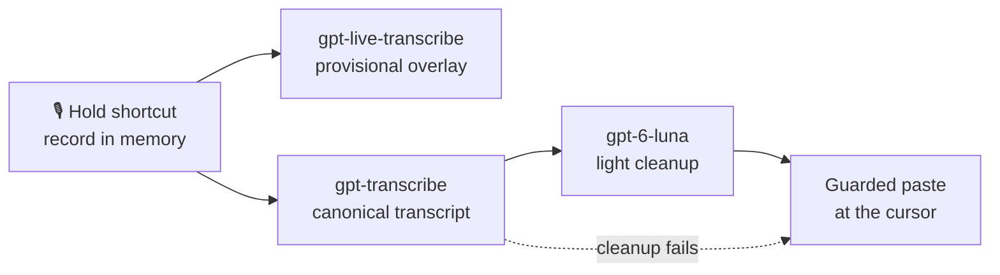

<div align="center">


# YapYap

**Talk it out.** Hold-to-talk dictation for your desktop, using your own OpenAI API key.

Hold your shortcut → speak → see words almost immediately → release → get an accurate, cleaned-up version at the cursor.


</div>

---

## Why YapYap

- **Bring your own key.** Audio goes straight to OpenAI. There is no dictation backend in between, and no analytics.
- **Feels instant, ends up accurate.** Live words show up in a floating overlay while you speak. When you release, the full recording is transcribed again for the final text.
- **Cleanup keeps your meaning.** An optional light pass removes filler words and fixes punctuation. Numbers, identifiers, URLs and filenames are left as you said them.
- **Your dictation isn't lost.** Audio and transcripts stay in memory. If a stage fails, you can retry, copy the original transcript, or paste again into a new target.
- **Safe insertion.** YapYap checks the destination before it pastes and refuses if the app, caret or window changed. Your clipboard is restored afterward, and a newer copy is never overwritten.

## How it works



When stages disagree, YapYap trusts them in this order:
**original audio › canonical transcript › cleaned transcript › live preview**.
Each phase can be turned off on its own under **Processing phases** in the app.

## Status

> Last updated November 2026 · `main` @ `8c6793b`

| Area | Status |
| --- | --- |
| **Windows** core dictation (record → live overlay → transcribe → clean up → insert) | ✅ Verified |
| **Windows** failure recovery, cancellation, saved-output retry | ✅ Verified |
| **Windows** per-user NSIS installer (`0.1.0`, x64) | ✅ Builds · 🟡 unsigned test builds |
| **macOS** parity probes: recording/overlay, insertion/clipboard, pipeline/recovery | ✅ All 3 groups passed (packaged app, Apple Silicon) |
| **macOS** Developer ID signing, notarization, downloaded-app acceptance | 🟡 Pending |
| **Windows** native regression after the macOS port | 🟡 Pending ([checklist](desktop/scripts/windows-regression-verification.md)) |
| Evaluation corpus and latency/accuracy baseline | ⬜ Not started |
| VAD segmentation and incremental transcription | ⬜ Not started |
| Privacy and lifecycle audit | ⬜ Not started |

Task-by-task progress lives in [TASKS.md](TASKS.md). The reasoning behind decisions is recorded in [DECISIONS.md](DECISIONS.md).

## Install

### Windows

1. Run `YapYap_0.1.0_x64-setup.exe`, then launch **YapYap** from the Start menu.
   It installs per user, to `%LOCALAPPDATA%\YapYap`.
2. Open **Settings**, save your OpenAI API key, allow microphone access, and choose a shortcut. The default is `Ctrl+Alt+F8`.
3. Closing the window keeps YapYap running in the tray. Choose **Quit** from the tray to exit.

<details>
<summary>Upgrading from the earlier <b>BYOK Dictation</b> build</summary>

Quit the old app and uninstall it before you install YapYap. Leave **Delete application data** unchecked to keep your preferences. The app ID, preference storage key and Credential Manager target are unchanged, so your saved API key carries over.

</details>

### macOS

No downloadable build has been published yet. To build and install locally, see [Develop → macOS](#macos-1).

## Develop

You need Node.js, Rust and the Tauri 2 prerequisites for your platform. All app source is in [`desktop/`](desktop/).

### Windows

```powershell
cd desktop
npm install
npm run tauri -- dev
```

To build a local unsigned installer, run `npm.cmd run release:windows`. The output goes to `desktop/src-tauri/target/release/bundle/nsis/`. See the [Windows release guide](desktop/RELEASE.md) for signing and release acceptance.

### macOS

```sh
cd desktop
npm ci
npm run dev:macos          # development app
npm run install:macos      # build, sign, replace /Applications/YapYap.app and launch it
```

`install:macos` keeps a single signed copy of the app. That way the Accessibility, Microphone and Keychain grants survive rebuilds.

### Tests

```sh
npm test                   # deterministic frontend and platform tests
npm run test:ui            # rendered UI checks (Playwright)
npm run test:group3        # macOS group 3 regression suite
```

Real API checks are opt-in. Regular tests use fixtures and fakes.

## Project layout

```
YapYap/
├── desktop/
│   ├── src/                 # React UI, dictation controller, session and recovery logic
│   │   └── platform/        # build-time platform modules (windows / macos / unsupported)
│   ├── src-tauri/           # Rust: capture, credentials, shortcuts, overlay, insertion, transport
│   └── scripts/             # tests, benchmarks, release scripts and verification notes
├── REQUIREMENTS.md          # product requirements (P0 / P1 / P2)
├── TASKS.md                 # incremental build plan and status
├── DECISIONS.md             # decision log
├── MACOS_PROBES.md          # macOS feature-parity checklist
└── KEY_SECURITY.md          # API-key handling and leak audit
```

## Privacy

- Your API key is stored in Windows Credential Manager or the macOS Keychain. Only native code reads it, and it never goes through the UI layer.
- Audio is kept in memory only. It is released after a successful insert or when you discard the session. Quitting the app or a crash loses any pending audio.
- Audio and transcripts go only to the configured provider (OpenAI). Dictated text and keys are never logged.

See [KEY_SECURITY.md](KEY_SECURITY.md) for the repeatable local leak audit.

## Roadmap

After the full P0 pipeline is done: personal vocabulary and app-aware context, undo and a raw-vs-cleaned comparison view, true inline live transcription, formatting voice commands, per-app profiles, and offline/local models. See [REQUIREMENTS.md](REQUIREMENTS.md) and the **Deferred after P0** section of [TASKS.md](TASKS.md).
